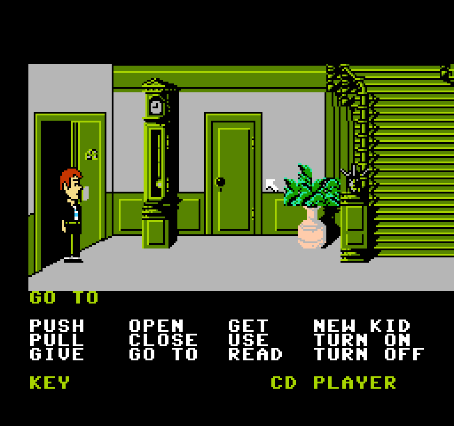
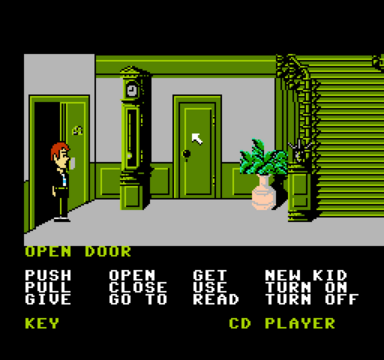
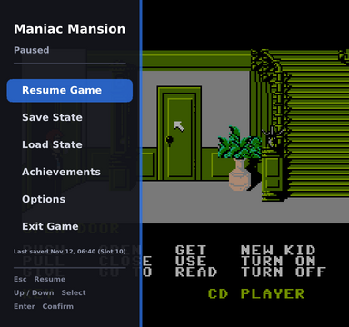
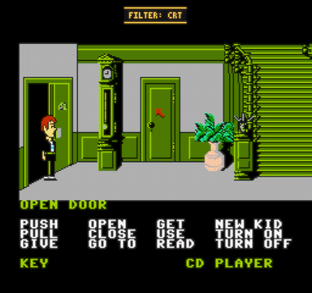
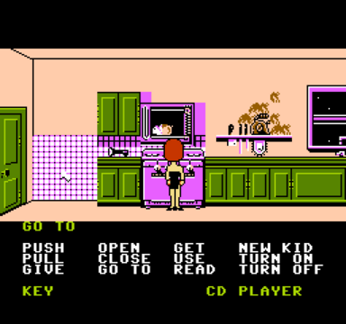
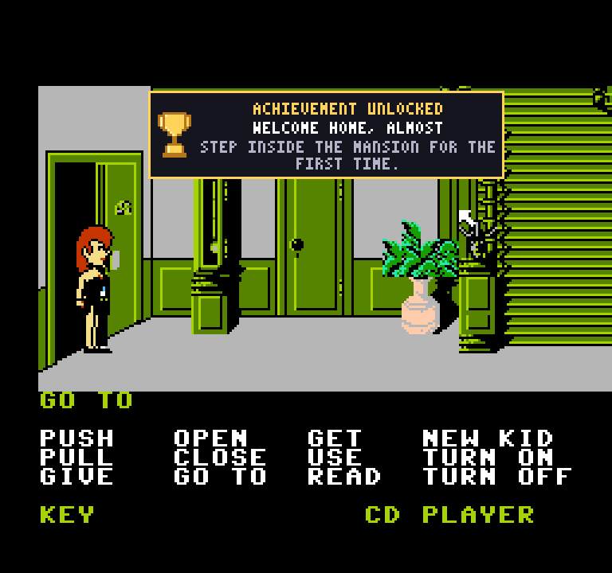

# Maniac Mansion NES PC

Play the **Maniac Mansion NES prototype** on PC with a mouse, as a real point-and-click adventure. The port does not replace the game's logic: it hooks a few spots in the ROM and lets the game run its own verb scripts, so a right click does exactly what the game itself would do. It also adds a pause menu, save slots, volume controls and picture filters. Built with [NESRecomp](https://github.com/mstan/nesrecomp).

**No game data is included.** You need your own dump of `Maniac Mansion (Prototype).nes`.



| Right click previews the action | Pause menu | CRT filter |
|---|---|---|
|  |  |  |



*Screenshots show the original game, © Lucasfilm Games / LucasArts.*

## Download

Get `ManiacMansion_NES_PC_win64.zip` from the [latest release](https://github.com/MeteorMessGames/ManiacMansion_NES_PC/releases/latest) (Windows 64-bit). Unzip it, put your ROM in the folder named exactly `Maniac Mansion (Prototype).nes`, and double-click `ManiacMansion.exe`. Only that exact ROM works.

## Features

- Full mouse-driven point and click, over the whole screen.
- Context-sensitive right click that uses the game's own object and verb logic.
- Inventory scrolling with the mouse wheel, and the classic two-step commands.
- The game's own save and restore, from the middle mouse button.
- Pause menu with 10 save-state slots, each with a screenshot.
- Music and sound effect volume, mouse and key speed.
- Three picture filters (Sharp, CRT, CRT Strong), including a GPU CRT.
- Fullscreen, fixed or automatic scaling, square pixels or 4:3 TV shape.
- Controller support.
- Achievements (on the [`achievements` branch](https://github.com/MeteorMessGames/ManiacMansion_NES_PC/tree/achievements)): rated Common, Rare, Epic and Legendary, with a trophy page in the pause menu.
- A launch-time update check (turn off with `UpdateCheck = 0` in `config.ini`).

The full player guide (controls, saving, tips) is in [README.txt](README.txt), which ships next to the exe.

## Achievements



Achievements live on the [`achievements` branch](https://github.com/MeteorMessGames/ManiacMansion_NES_PC/tree/achievements): rated Common, Rare, Epic and Legendary, with a banner and sound on each unlock and a trophy page in the pause menu.

## Mouse

| Button | Action |
|---|---|
| Left click | Walk, pick a verb or item (GO TO on objects); skips the current message when you click above the room or during a cutscene |
| Right click | Context verb on the object under the cursor; skips cutscenes |
| Middle click | In-game save menu (Save game / Restore / New game); click again inside it to go back to the game |
| Wheel | Scroll the inventory |

## Controller

| Input | Action |
|---|---|
| D-pad / left stick | Move the cursor (speed follows Options > Key Speed) |
| A | Left click |
| B | Right click (context verb, skips cutscenes) |
| X | Cycle the verb (Select) |
| Y | Skip the current message |
| Start, Back / Select, Guide | Pause menu; D-pad moves in it, A confirms, B goes back |
| Left shoulder | The game's own menu (save / restore) |

## Keyboard

| Key | Action |
|---|---|
| Esc | Pause menu |
| Enter / Space | Skip a cutscene |
| F9 | Filter: Sharp / CRT / CRT Strong |
| F11 | Fullscreen |
| F12 | Screenshot |
| Tab | Cycle the verb (Select) |
| Z | A button (same as left click) |
| Arrow keys | NES d-pad |

## How it works

The port hooks the game at a few ROM sites (listed in `game.toml`, each checked by CRC32): the joypad reads (mouse buttons become A / B / Start), the cursor clamp (so the mouse reaches the screen edges), the game's save, and the audio mix.

The context verb comes from reading the room's object tables and each object's SCUMM v2 verb scripts, for example whether its GET script really picks it up. The click is then replayed through the game's own verb and sentence variables, so the game runs the command itself.

Source file responsibilities, hook sites and the context verb details are in **[ARCHITECTURE.md](ARCHITECTURE.md)**.

## Building

Full steps are in **[BUILDING.md](BUILDING.md)**. In short: you need NESRecomp at the pinned commit with the small runner patch from [`runner-patches/`](runner-patches/) applied, this folder inside that checkout, CMake 3.20+, SDL2, and your own ROM:

```sh
cmake -S . -B build -DMM_ROM="/path/to/Maniac Mansion (Prototype).nes"
cmake --build build
```

## License

This project's code is licensed under the **MIT License**; see [LICENSE](LICENSE).

Bundled third-party files keep their own licenses: `third_party/stb_truetype.h` (public domain / MIT) and the DejaVu Sans Bold font embedded in `menu_font.h` (DejaVu fonts license). The Windows release also contains the NESRecomp runner (PolyForm Noncommercial 1.0.0) and SDL2 (zlib); their license texts ship in the release's `licenses` folder. The runner patch is a small derivative of NESRecomp and keeps its license; see [BUILDING.md](BUILDING.md).

## Credits

- Maniac Mansion is © Lucasfilm Games / LucasArts. This project contains no game code or data and is not affiliated with or endorsed by them.
- [NESRecomp](https://github.com/mstan/nesrecomp) by mstan.
- [stb_truetype](https://github.com/nothings/stb) (public domain / MIT).
- [DejaVu fonts](https://dejavu-fonts.github.io/) (free license).
